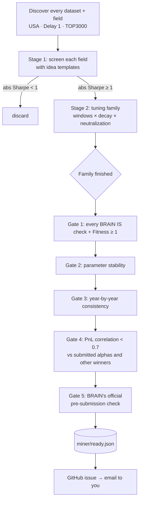

# Quant — an automated alpha miner for WorldQuant BRAIN

This repository contains an **autonomous research agent** that finds alphas for
[WorldQuant BRAIN](https://platform.worldquantbrain.com) ready for submission. It runs on GitHub's servers on a
schedule, so neither your PC nor an AI assistant needs to be running. It searches every dataset your
account can use. It keeps only alphas that pass every BRAIN submission test, including the correlation tests,
and also a set of stricter accuracy filters of its own. It then tells you which ones to submit.

> **This repository is public, but the results are not.** The code is open. Everything the miner
> finds (formulas, simulation history, logs) is stored only in `miner_state.enc`, which is encrypted with a key
> held in GitHub Secrets and on the owner's PC. Public logs and notifications show alpha IDs and statistics,
> never formulas. See [Privacy model](#privacy-model).

---

## Contents

1. [Background: what BRAIN is and what an alpha is](#1-background-what-brain-is-and-what-an-alpha-is)
2. [What's in this folder](#2-whats-in-this-folder)
3. [How the miner works](#3-how-the-miner-works)
4. [The accuracy filters, and why each exists](#4-the-accuracy-filters-and-why-each-exists)
5. [Expected results](#5-expected-results)
6. [Setup: running it in the cloud (GitHub Actions)](#6-setup-running-it-in-the-cloud-github-actions)
7. [Daily routine: submitting alphas](#7-daily-routine-submitting-alphas)
8. [Running it locally instead](#8-running-it-locally-instead)
9. [Configuration](#9-configuration)
10. [Limits, risks and rules](#10-limits-risks-and-rules)
- [Privacy model](#privacy-model)
11. [Track record](#track-record)

---

## 1. Background: what BRAIN is and what an alpha is

**WorldQuant BRAIN** is WorldQuant's online platform for testing trading ideas against history ("backtesting").
Users submit good ideas to the **WorldQuant Challenge**. Reaching 10,000 Challenge points makes a user
eligible for the paid **Research Consultant** programme, and Nigeria is an eligible country.

**An alpha** is a formula written in BRAIN's *Fast Expression* language, for example:

```
ts_rank(operating_income, 252)        # "buy companies whose operating income is high vs. its past year"
```

Every trading day across a 5-year in-sample (IS) period, BRAIN:

1. evaluates the formula for every stock in the universe (e.g. the 3,000 most liquid US stocks);
2. **neutralizes** it by subtracting the average (within the market, industry or sub-industry), so that the
   money in long positions equals the money in short positions. The result profits from *relative* moves,
   whichever way the market goes;
3. scales the values to a fixed $20M book and applies decay and truncation (max weight per stock);
4. holds the positions for one day and records the profit or loss (PnL).

The result is a PnL curve and a set of statistics:

| Metric | Meaning | Needed to submit (Delay 1) |
|---|---|---|
| **Sharpe** | `sqrt(252) × mean(daily PnL) / std(daily PnL)`: how consistent the returns are | > 1.25 |
| **Fitness** | `Sharpe × sqrt(|Returns| / max(Turnover, 0.125))`: rewards returns and low trading | > 1.0 |
| **Turnover** | share of the book traded each day | 1% – 70% |
| **Weight** | no stock above 10% of the book; enough stocks get weight | pass |
| **Sub-universe** | the alpha must still work on the next-smaller, more liquid universe | `≥ 0.75·sqrt(sub/full)·Sharpe` |
| **Self-correlation** | PnL correlation with your own submitted alphas | < 0.7 (or 10% higher Sharpe) |

BRAIN rates Fitness as Average (> 1), Good (> 1.5), Excellent (> 2) or Spectacular (> 2.5).
**Challenge score:** each day's score (max 2,000) grows with the *number* and *quality* of alphas submitted.
Quality means high fitness, low self-correlation, Delay 1 and a smaller universe. One or two good, uncorrelated alphas a
day is the sweet spot.

The full platform documentation, downloaded via the API, is summarized in `docs/ALL_DOCS.md`. That folder is
kept out of git; see below.

## 2. What's in this folder

| Path | What it is |
|---|---|
| `miner.py` | **The agent.** Continuous, restart-proof alpha search (explained below). |
| `brain.py` | Small BRAIN API client: login, simulate, official pre-submission check, daily PnL, dataset and field catalogue. Also a CLI for running hand-written ideas: `python brain.py ideas/batch1.json`. |
| `vault.py` | Encrypts `miner/` into `miner_state.enc` and decrypts it back (`pack` / `unpack` / `newkey`). |
| `miner_state.enc` | **The miner's memory, encrypted.** The only part of the results that is committed. |
| `.github/workflows/alpha-miner.yml` | Runs the miner 24/7 on GitHub's servers (4 runs of about 5.5 hours a day). It restores and saves the encrypted state. |
| `requirements.txt` | Python dependencies (`requests`, `cryptography`). |

Working files, decrypted into `miner/` and never committed in plain form:

| Path | What it is |
|---|---|
| `miner/ready.json` | **The output:** alphas that passed everything, best Fitness first. |
| `miner/tried.jsonl` | Every simulation the miner has run (one JSON per line). Used to resume and to never repeat work. |
| `miner/families.json` | Promising ideas whose tuning variants are still being simulated. |
| `miner/fields.json` | Cached catalogue of usable data fields (refreshed weekly). |
| `miner/state.json` | Today's simulation count (enforces the daily cap). |
| `miner/miner.log` | Full activity log, including formulas (the last 5,000 lines are kept). |

Local-only folders (git-ignored): `ideas/` and `results/` (the first hand-run research batches) and `docs/`.
| `start_miner.vbs` | Windows helper: starts the miner hidden in the background (local mode only). |
| `brain_fetch_docs.ps1` | Windows helper: downloads BRAIN's documentation and operator list into `docs/` (git-ignored, because it contains WorldQuant's content and personal account details). |

## 3. How the miner works



**1. Discovery.** It asks the API for every dataset the account can use for USA / Delay 1 / TOP3000. Currently
that's 14 datasets: analyst estimates, two fundamentals sets, fundamental scores, risk metrics, two news sets,
two options sets, two price-volume sets, two social-media sets and the universe set. It then lists every field
with coverage of at least 30%, about **4,000 fields**. The fields are interleaved across datasets, least-crowded
first (fewest existing alphas on BRAIN), so the search spreads over all the data early and favours fields that
other users rarely touch. Those fields are less likely to be correlated with existing alphas.

**2. Stage 1: screening.** First come the **seed ideas**: about 50 signals taken from research, including the academic
anomaly literature, WorldQuant's own *101 Formulaic Alphas* paper, BRAIN's documentation, and alphas the
BRAIN community has published along with their stats. Seeds are kept in `miner/seeds.json`, inside the
encrypted state, because a seed that passes *is* an alpha formula. Then every field `x` is plugged into the
generic templates, pass by pass, so the broadest search comes first:

| Template | Pass | Expression | Idea |
|---|---|---|---|
| `tsrank` | 1 | `group_rank(ts_rank(x, w), industry)` | Is `x` high versus its own history, compared with industry peers? (the community's most reliable pattern) |
| `zscore` | 1 | `ts_zscore(x, w)` | How unusual is today's `x` for this stock? |
| `revision` | 2 | `group_rank(ts_delta(x, w)/(abs(ts_delay(x, w)) + 0.0001), industry)` | Percentage revision. Analysts and fundamentals drift after revisions |
| `volnorm` | 2 | `group_rank(ts_delta(x, w)/(ts_std_dev(x, w) + 0.0001), subindustry)` | Change measured in units of its own volatility |
| `avdiff` | 2 | `group_neutralize(ts_av_diff(x, w), subindustry)` | Distance from its own recent average |
| `level` | 3 | `group_rank(x, subindustry)` | Is `x` high compared with direct competitors? |
| `to_cap` | 3 | `group_rank(x/cap, subindustry)` | Fundamental/analyst value per dollar of market cap (a "yield") |

**Preparing a field** (`field_expr`):
- *Trap fields are skipped:* corporate-action bookkeeping (`adjfactor`, `split`, `dividend`) and static relationship
  counts, whose ~1% turnover caps Fitness however good the Sharpe.
- *Option price levels* are divided by `close`.
- *Vectors* are summed (counts, buzz) or averaged (scores).
- *Sparse news vectors* get a 504-day backfill, sparse fundamentals 252 days and other sparse fields 66 days.

**Settings per data type.** What works differs by dataset, so each category has its own screening setup:

| Data | Neutralization (screen → alternative) | Screening decay |
|---|---|---|
| Fundamental | sub-industry → industry | 2 |
| Analyst, model | industry → sub-industry | 2 |
| Options | sector → market | 4 |
| News, social media | industry → sub-industry | 6 |
| Price-volume | industry → market | 10 |

A negative Sharpe is just as informative as a positive one: the idea is simply flipped (`-(expr)`).

**3. Stage 2: tuning.** Any screen with |Sharpe| ≥ 1.0 opens a **family** of up to 13 variants:
3 lookback windows × 2 decays × the category's 2 neutralizations, plus the original. The decays are chosen from the
screen's turnover, following WorldQuant's own rule of thumb:

| Screen turnover | Decays tried |
|---|---|
| > 50% | 12, 20 |
| > 30% | 6, 12 |
| > 12.5% | 2, 6 |
| ≤ 12.5% | 0, 3. Below 12.5% turnover, decay cannot raise Fitness, so it's kept low to preserve returns |

Families run before any new screening, so promising ideas are finished quickly.

**4. Gates.** When every variant in a family is done, the best few are put through the filters in
section 4. The first to pass all of them goes on the ready list. If it is correlated with an existing winner,
only the one with higher Fitness is kept.

**5. Persistence.** Everything is written to `miner/` as it happens. A run can be stopped at any moment (time limit,
outage, PC off) and the next run continues where it left off; nothing is simulated twice. In the cloud,
each run commits `miner/` back to the repository.

**Operational behaviour**

- Simulates 3 ideas at a time (BRAIN's concurrency limit) and stops for the day at `MINER_MAX_SIMS_PER_DAY`
  (default 600), because BRAIN allows API use only "with low intensity".
- Retries dropped connections automatically. During an internet outage, the idea in progress is put back in
  the queue.
- Re-reads your submitted alphas every hour. Anything you submit leaves the ready list, and every new
  candidate is checked for correlation against it.

## 4. The accuracy filters, and why each exists

Passing BRAIN's tests on 5 years of history is not the same as working in the future. The real goal is
**out-of-sample (OS)** performance after submission: alphas that fade there are eventually decommissioned. The
miner therefore applies stricter checks than BRAIN does.

| Gate | Rule | Why |
|---|---|---|
| **1. BRAIN IS checks** | No failed check (Sharpe, Fitness, turnover, weight, sub-universe); Fitness ≥ 1 | The minimum BRAIN needs before a submission is accepted. |
| **2. Parameter stability** | At least 34% of the family's variants reach Sharpe ≥ 1 | Trying many variants and keeping the best is a form of overfitting. If only one lucky window/decay combination works, the "signal" is probably noise. A real effect survives small parameter changes. |
| **3. Year consistency** | At most 1 losing year in the IS period (Sharpe per calendar year), **and** a Sharpe of at least 0.5 over the last 2 years | Rejects alphas whose Sharpe comes from a single great year, or that have stopped working recently. Both tend to fail out-of-sample. |
| **4. Correlation** | Daily-PnL correlation < 0.7 with every alpha you've submitted and with every other winner | Mirrors BRAIN's self-correlation test before spending the official check. It also keeps the ready list *diverse*, which is what the Challenge rewards. |
| **5. Official check** | BRAIN's own pre-submission check (the "Check Submission" button) passes in full | The final word, including BRAIN's official self-correlation calculation. |

Every winner in `ready.json` records its Sharpe, Fitness, turnover, returns, drawdown, stability, Sharpe per year,
and maximum correlation, so you can see *why* it was accepted.

## 5. Expected results

These are honest estimates; the real numbers build up in `miner/tried.jsonl` over the first days.

- **Throughput:** each simulation takes about 1–2 minutes on BRAIN's side, with 3 running in parallel. That's
  roughly 80–100 simulations per hour of mining, up to the daily cap (`MINER_MAX_SIMS_PER_DAY`, default 600).
  Running 24/7 in the cloud, the cap is reached most days. Runs that start after the cap is used up exit
  immediately and cost almost nothing.
- **Hit rate:** most raw screens fail. Typically only a few percent of fields reach |Sharpe| ≥ 1, and only a
  fraction of those survive all five gates. A realistic expectation is **somewhere between one winner every few
  days and a few per day**. It falls over time, because every alpha you submit makes it harder for new ones to
  pass the correlation gates.
- **Quality of winners:** Sharpe ≥ 1.25, Fitness ≥ 1.0, often in the "Good" band (Fitness > 1.5).
  They are stable across parameters, profitable in almost every year, and uncorrelated with your portfolio.
- **What it will *not* do:** guarantee out-of-sample performance (no one can), produce Spectacular alphas on
  demand, or submit for you. Submitting is permanent, so a human decides.
- **The search space is finite:** with the current templates, a full pass over all ~4,000 fields is roughly
  25,000 screens plus tuning, about 6–8 weeks at the daily cap. When everything has been tried, the miner idles and
  re-checks for new datasets every 6 hours. At that point the best upgrade is new templates in `TEMPLATES`.

## 6. Setup: running it in the cloud (GitHub Actions)

1. **Repository secrets** (*Settings → Secrets and variables → Actions → New repository secret*):
   - `BRAIN_EMAIL`: BRAIN login email
   - `BRAIN_PASSWORD`: BRAIN password
   - `MINER_STATE_KEY`: the encryption key (`python vault.py newkey` creates one). **Keep a copy.** Without it
     the saved progress cannot be decrypted, and the miner would start its search from scratch.
2. **Start it:** under *Actions → alpha-miner → Run workflow*. After that it runs by itself, every 6 hours, around the clock.
3. **Get notified:** new winners open a GitHub issue, which GitHub emails to you. Make sure *Watch* is set for the repository.

**Schedule and minutes.** GitHub limits a job to 6 hours, so a run starts at 00:07, 06:07, 12:07 and 18:07 UTC
and mines for about 5.5 hours (`MINER_MINUTES`, default 330). Public repositories get unlimited free Actions
minutes. GitHub pauses scheduled workflows in a repository with no activity for 60 days. The miner's own commits count
as activity, but if it ever stops, re-enable it under *Actions*.

**Identity check.** BRAIN sometimes asks for a one-off identity check when a login comes from a new location,
such as GitHub's servers. If it does, the run fails with a message containing a link. Open it, complete the check,
and re-run the workflow.

## Privacy model

| What | Where it's visible |
|---|---|
| Code (`*.py`, workflow, README) | Public |
| Formulas, simulation history, ready list, full log | Only inside `miner_state.enc` (encrypted with `MINER_STATE_KEY`) |
| Actions run logs | Public, but in the cloud the miner prints only counts, Sharpe/Fitness numbers and alpha IDs |
| Notification issues | Public: alpha IDs and statistics only. An alpha ID can be opened only from the owner's BRAIN account |
| BRAIN password | GitHub Secrets only (encrypted and masked in logs) |

## 7. Daily routine: submitting alphas

1. Open the newest GitHub issue. The best alpha is listed first.
2. On BRAIN, go to **Alphas → Unsubmitted**, find the Alpha ID, open it, check it and click **Submit**.
   Nothing needs re-typing, because the miner's simulations already live in your account.
3. Submit **1–2 per day**. The miner drops submitted alphas from the list on its next run, and correlation-checks
   every future candidate against them.
4. To see the full ready list with formulas, or to re-check alphas that have waited a few days, do this on your PC:
   ```powershell
   git pull
   python vault.py unpack     # needs MINER_STATE_KEY set on this PC
   python miner.py ready      # prints OK / NOW FAILS <check> for each alpha
   ```

## 8. Running it locally instead

```powershell
pip install -r requirements.txt
$env:BRAIN_EMAIL = "you@example.com"; $env:BRAIN_PASSWORD = "..."; $env:MINER_STATE_KEY = "..."
python vault.py unpack       # continue from the cloud's progress
python miner.py              # runs until stopped (Ctrl+C)
python vault.py pack         # then commit miner_state.enc to hand progress back to the cloud
```

On Windows, `start_miner.vbs` starts the miner hidden. **Never run local and cloud mining at the same time:** they would
work from different copies of the progress and overwrite each other. Disable the workflow first.

## 9. Configuration

| Setting | Where | Default | Effect |
|---|---|---|---|
| `MINER_MINUTES` | env / repository variable | `0` locally (forever), `330` in Actions | Mine this long, then save and exit |
| `MINER_MAX_SIMS_PER_DAY` | env / repository variable | `600` | Daily simulation cap |
| `MIN_FITNESS`, `MIN_STABILITY`, `MAX_BAD_YEARS`, `MIN_RECENT_SHARPE`, `MAX_CORRELATION` | top of `miner.py` | 1.0, 0.34, 1, 0.5, 0.7 | Strictness of the gates |
| `TEMPLATES`, `CATEGORY_SETTINGS`, `tune_decays`, `TRAP_FIELDS` | `miner.py` | see file | The idea space being searched |
| Seed ideas | `miner/seeds.json` (encrypted) | ~50 researched signals | Tried before the generic templates |
| `SCOPE` | `miner.py` | USA / D1 / TOP3000 | Region, delay, universe |

## 10. Limits, risks and rules

- **BRAIN API rules:** WorldQuant permits programmatic access "when API communication is conducted with low
  intensity". The concurrency limit (3) and daily cap (600) are deliberately conservative. Don't raise them aggressively.
- **GitHub Actions rules:** GitHub expects Actions to be used for the repository's own software. Here the workflow
  runs this repository's program. If GitHub ever objects, the same code runs unchanged on any small Linux server
  (e.g. Oracle Cloud *Always Free*): `pip install -r requirements.txt`, set the three environment variables, run
  `python miner.py` under `systemd` or `tmux`.
- **Never share formulas publicly.** Alphas are your intellectual property, and posting them can break BRAIN's
  terms. That's why everything sensitive is encrypted.
- **Overfitting:** the gates reduce it but cannot remove it. In-sample results are a guide, not a promise.
- **Selection decay:** as your portfolio grows, fewer candidates pass correlation. New templates and new
  datasets (e.g. after becoming a consultant: other regions, 85,000+ fields) keep the pipeline productive.

## Track record

| Date | Alpha ID | Data | Sharpe | Fitness | Turnover | Status |
|---|---|---|---|---|---|---|
| 2026-10-14 | `KPmdPPpk` | Analyst estimates | 1.99 | 1.75 | 11.9% | ACTIVE |
